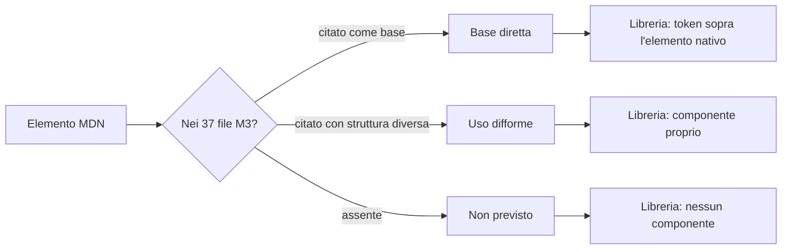

# Scouting: elementi HTML standard e Material 3

Documento di scouting. Data della rilevazione: 12 novembre 2026.

## Scopo e perimetro

Il documento confronta gli elementi HTML elencati nella [referenza MDN degli elementi](https://developer.mozilla.org/en-US/docs/Web/HTML/Reference/Elements) con le regole del sistema Material 3 usate dalla libreria. Per ogni elemento con resa grafica o comportamento interattivo indica:

- l'effetto grafico predefinito del browser;
- il rapporto con Material 3: uso diretto, uso difforme, assenza;
- l'uso attuale nella libreria, misurato su `src/*.ts`.

Restano fuori dal perimetro gli elementi senza resa propria: `<html>`, `<head>`, `<body>`, `<title>`, `<meta>`, `<link>`, `<style>`, `<script>`, `<noscript>`, `<base>`, `<template>` e `<slot>`. `template` e `slot` compaiono solo come meccanismo di composizione e sono trattati nella sezione Web Components.

## Fonti

| Fonte | Contenuto usato |
| --- | --- |
| [MDN, HTML elements reference](https://developer.mozilla.org/en-US/docs/Web/HTML/Reference/Elements) | elenco completo degli elementi, raggruppati per funzione, letto il 12 novembre 2026 |
| `capabilities-ds-material/references/components` | 37 file di componente Material 3, fotografia dsdb 38.2.9 del 13 ottobre 2026 |
| `capabilities-ds-material/references/foundations` | tipografia, forma, colore, elevazione, stati, token di progetto |
| `src/*.ts` della libreria | conteggio delle occorrenze di ogni elemento nei template Lit |

## Metodo

1. Ogni elemento della referenza MDN è stato cercato nei 37 file di componente Material 3, sia come nome di elemento (`<dialog>`, `
`) sia come pagina MDN citata nella riga `Platform`.
2. Ogni elemento è stato contato nei template Lit della libreria con una ricerca su `src/*.ts`.
3. Ogni elemento è stato classificato in uno dei tre esiti seguenti.

| Esito | Significato |
| --- | --- |
| Base diretta | Material 3 usa l'elemento nativo come superficie del componente e ne sostituisce solo colori, forma, tipografia e spaziature |
| Uso difforme | Material 3 raggiunge una funzione diversa con una struttura diversa, oppure ridefinisce anatomia e interazione dell'elemento |
| Non previsto | Il catalogo Material 3 non contiene un componente per quell'elemento |

## Struttura e contenuto

| Elemento | Resa predefinita | Material 3 | Libreria |
| --- | --- | --- | --- |
| `<h1>`–`<h6>` | blocchi con scala dimensionale del browser | ruolo tipografico, nessuna associazione all'elemento: `typography.md` definisce display, headline, title, body, label senza mappatura | `<h1>` nel titolo di `bolle-app-bar` (`src/surfaces.ts:36`) |
| `
` | blocco con margini verticali | nessuna associazione; il testo dei componenti usa body-medium o body-large secondo il componente | `
` nel contenuto del dialog e nello snackbar |
| `
` | riga con bordo in rilievo | componente divider: 1dp, colore `outline-variant`, spazio 8dp (`divider.md`, riga `Platform` con `
`) | `
` nel divisore (`src/surfaces.ts:150`) |
| `<ul>`, `<ol>`, `<li>` | elenco con rientranza e marcatori | componente list: token `list.*`, arresto del rientro, `role="listbox"` quando la lista è selezionabile (`lists.md`, riga `Platform` con `<ul>` e `<li>`) | `<ul>` in navigazione, lista, risultati di ricerca, sottoliste |
| `<menu>` | elenco non ordinato senza differenze di resa | i menu Material 3 sono superfici con `role="menu"` aperte da un trigger, non l'elemento `<menu>` | non usato |
| `<dl>`, `<dt>`, `<dd>` | coppie termine/descrizione con rientro | assente dal catalogo | non usato |
| `<figure>`, `<figcaption>` | blocco con margini e didascalia | assente; le card e il carosello ospitano media in slot | non usato |
| `<blockquote>`, `<q>`, `<cite>` | rientro e virgolette; corsivo per `cite` | assente | non usato |
| `<pre>`, `<code>`, `<kbd>`, `<samp>`, `<var>` | monospazio del browser | assente: nessun ruolo tipografico monospazio nella scala | non usato |
| `<mark>`, `<s>`, `<del>`, `<ins>` | evidenziazione, barrato, sottolineato | assente | non usato |
| ``, ``, `<abbr>`, `<dfn>`, `<bdi>`, `<bdo>`, `<wbr>`, ` ` | pedice, apice, puntini dell'abbreviazione, interruzione di riga | assente | non usato |
| `<time>`, `<data>` | resa identica al testo | assente | non usato |
| `<ruby>`, `<rt>`, `<rp>` | annotazioni ruby | assente | non usato |
| `<address>` | corsivo con margini | assente | non usato |
| `<hgroup>` | raggruppamento di titoli | assente | non usato |
| `<header>`, `<footer>` | blocchi senza resa | usati come contenitori nei componenti: `app-bars.md` cita `<header>`, il dialog usa `<header>` e `<footer>` per titolo e azioni | `<header>` in app bar, sheet, drawer, dialog; `<footer>` in dialog, sheet, picker |
| `<main>`, `<section>`, `<article>`, `<aside>`, `<nav>` | blocchi senza resa | `cards.md` cita `<article>`, `navigation-bar.md` e `navigation-rail.md` citano `<nav>` e `<a>` | `<article>` nella card, `<section>` nel carosello e nei pannelli dei tab, `<aside>` nello sheet standard, `<nav>` nella navigazione |
| `<search>` | contenitore di ricerca senza resa | componente search; `search.md` cita `<label>` e `<input>` | `<search>` come radice del componente search (`src/forms.ts:416`) |
| `
`, `` | contenitori senza resa | usati come contenitori interni; `badges.md` cita `` | 44 occorrenze di `
`, 59 di `` |

## Tabelle

| Elemento | Resa predefinita | Material 3 | Libreria |
| --- | --- | --- | --- |
| `<table>`, `<caption>`, `<colgroup>`, `<col>`, `<thead>`, `<tbody>`, `<tfoot>`, `<tr>`, `<th>`, `<td>` | griglia con bordi e spaziatura del browser | nessun componente tabella nei 37 file; il dato tabulare è coperto solo dalla lista | `<table role="grid">` per il calendario del date picker (`src/pickers.ts:336`), con `thead`, `tbody`, `tr`, `th`, `td` |

La tabella dei dati è l'assenza più ampia del catalogo. Material 3 definisce altezze, colori e stati per la riga di lista (`list-item-height` 56, 72, 88), non per una cella di tabella. Una tabella dati costruita con la libreria usa quindi i token del testo e del divisore, senza token di riga, intestazione fissa o selezione di riga.

## Form e controlli

| Elemento | Resa predefinita | Material 3 | Libreria |
| --- | --- | --- | --- |
| `<button>` | pulsante del browser | componente button: `buttons.md`, `icon-buttons.md`, `chips.md`, `fab-menu.md`, `split-button.md`, `tabs.md` citano `<button>` come base | 32 occorrenze; ogni controllo azione è un `<button>` interno |
| `<form>` | blocco senza resa | non citato; la libreria partecipa alla form association con `ElementInternals` | 1 occorrenza nella ricerca |
| `<label>` | testo cliccabile associato al controllo | `text-fields.md`, `search.md`, `sliders.md` citano `<label>` | 14 occorrenze, comprese le etichette flottanti dei campi |
| `<fieldset>`, `<legend>` | cornice con bordo e titolo | `radio-button.md` e `segmented-buttons.md` citano `<fieldset>` e `<legend>` come contenitore del gruppo | `fieldset` e `legend` nei segmented buttons (`src/forms.ts:781`) |
| `<input type="text">`, `email`, `tel`, `url`, `password` | campo con bordo interno del browser | componente text field: `text-fields.md` cita `<input>`; il campo filled e outlined sostituiscono bordo e sfondo con token | `<input>` nei campi di testo e nella ricerca |
| `<input type="checkbox">`, `radio` | quadrato e cerchio nativi | componenti checkbox e radio button, con `<input>` come base e stato disegnato dall'ombra | `<input>` nei checkbox, radio e segmenti |
| `<input type="range">` | cursore nativo con traccia sottile | componente slider: traccia 4dp, valore con forma a pillola, stop mark | `<input type="range">` nello slider, con `<datalist>` per gli stop e `<output>` per il valore |
| `<input type="search">` | campo con icona di cancellazione del browser | componente search: barra 56dp, angoli pieni, suggerimenti in lista | `<input type="search">` nella ricerca |
| `<input type="date">`, `time`, `datetime-local`, `month`, `week` | selettore nativo del browser | componenti date picker e time picker con calendario proprio e dialog | `<input type="text">` in sola lettura più dialog e `select` per mese e anno; nessun tipo data nativo |
| `<input type="number">` | campo con frecce di incremento | assente: nessun componente stepper; il text field copre l'inserimento numerico senza frecce | usato per l'anno nel date picker e per ore e minuti nel time picker in modalità inserimento |
| `<input type="file">` | pulsante e nome file del browser | assente: nessun componente di caricamento | non usato |
| `<input type="color">` | selettore colore del sistema | assente: Material 3 pubblica ruoli di colore, non un controllo di scelta colore | non usato |
| `<input type="submit">`, `reset`, `image`, `button` | pulsanti nativi | componenti button e icon button; la libreria non usa i tipi submit o reset come superficie | non usati |
| `<textarea>` | area di testo ridimensionabile | componente text field multiriga: `text-fields.md` cita `<textarea>` | 1 occorrenza nel campo multiriga |
| `<select>`, `<option>`, `<optgroup>` | menu a comparsa del sistema | nessun componente select nel catalogo; il token set contiene `md.comp.filled-select.*` e `md.comp.outlined-select.*` che riusano l'albero del text field (`text-fields.md`, sezione 8), e la scelta avviene in un componente di selezione annidato raggiunto da un'icona | `bolle-select` veste `option` e `optgroup` native con il menu Material; il date picker usa ancora il `select` nativo per mese e anno |
| `<selectedcontent>` | contenuto dell'opzione scelta nel select chiuso | assente | non usato |
| `<datalist>` | suggerimenti nativi del campo | assente; i suggerimenti sono il componente search con lista | `bolle-autocomplete` è la forma Material del campo con datalist, con lista in popover e filtro; `<datalist>` resta per gli stop dello slider |
| `<output>` | testo senza resa | assente | `<output>` per il valore corrente dello slider |
| `<progress>` | barra di avanzamento del browser | componente progress indicator: `progress-indicators.md` e `loading-indicator.md` citano `<progress>` come base | nessun `<progress>` nei template; la barra lineare è un `div` con `role="progressbar"` |
| `<meter>` | indicatore a barra con zone colorate | assente: il catalogo copre l'avanzamento di un'attività, non la misura di un valore | non usato |

## Elementi interattivi

| Elemento | Resa predefinita | Material 3 | Libreria |
| --- | --- | --- | --- |
| `<a>` | collegamento blu sottolineato | `navigation-bar.md` cita `<a>`; card e lista usano l'ancora quando esiste un `href` | 7 occorrenze in navigazione, card, lista e documentazione |
| `
`, `
` | triangolo di apertura e contenuto nascosto | assente; l'espansione esiste solo come interazione di lista (`list.expand.*`) e come sottomenu | non usato |
| `<dialog>` | finestra modale con sfondo di sfondo e chiusura con Escape | componenti dialog, bottom sheet, side sheet, navigation drawer: sei file citano `<dialog>` | `<dialog>` nelle varianti modali di dialog, sheet e picker, aperto con `showModal()`; le varianti standard usano `<aside>` e `<section>` |
| `<area>`, `<map>` | aree cliccabili su immagine | assente | non usato |
| `<geolocation>` (sperimentale) | controllo di condivisione posizione | assente | non usato |

## Media e contenuto incorporato

| Elemento | Resa predefinita | Material 3 | Libreria |
| --- | --- | --- | --- |
| ``, `<picture>`, `<source>` | immagine, con selezione della sorgente | assente come componente; card e carosello ospitano media in slot | non usati |
| `<audio>`, `<video>`, `<track>` | player nativo con controlli del browser e sottotitoli | assente: nessun componente di riproduzione | non usati |
| `<canvas>` | area di disegno trasparente | assente | non usato |
| `<svg>` | grafico vettoriale inline | assente come componente; `icons.md` fissa le regole delle icone | 8 occorrenze, come icone dei comandi e tracciati dei controlli |
| `<math>` | formula MathML | assente | non usato |
| `<iframe>`, `<embed>`, `<object>` | contenuto esterno con riquadro | assente | non usati |

## Web Components

| Elemento | Material 3 | Libreria |
| --- | --- | --- |
| `<slot>` | non citato; la libreria lo usa per composizione | 40 occorrenze |
| `<template>` | non citato | non usato: i template sono funzioni Lit |

## Elementi obsoleti

MDN elenca `<acronym>`, `<big>`, `
`, `<content>`, `<dir>`, `<fencedframe>`, ``, `<frame>`, `<frameset>`, `<image>`, `<marquee>`, `<menuitem>`, `<nobr>`, `<noembed>`, `<noframes>`, `<param>`, `<plaintext>`, `<rb>`, `<rtc>`, `<shadow>`, `<strike>`, `<tt>`, `<xmp>`. Material 3 non li tratta e la libreria non li usa. `<marquee>`, `
`, `` e `<big>` hanno resa grafica, quindi il browser può applicarli anche dentro un componente: nessun token li corregge. `<menuitem>` descrive una voce di menu, funzione che Material 3 copre con il componente menu.

## Elementi per esito

**Base diretta**: `<button>`, `<input>` nei tipi testo, ricerca, checkbox, radio e range, `<label>`, `<textarea>`, `<fieldset>` con `<legend>` per il gruppo radio, `<dialog>`, `
`, `<progress>`, `<nav>`, `<a>`, `<ul>` con `<li>`, `<article>`, `<header>`, ``, `<section>`, `<aside>`.

**Uso difforme**: `<select>` e `<option>` usati da Material 3 solo come base token di un campo con menu annidato; `<datalist>` sostituito da un campo con lista di suggerimenti; `<menu>` sostituito dalla superficie con `role="menu"`; `
` e `
` sostituiti dall'espansione di lista e dai sottomenu; `<fieldset>` e `<legend>` ammessi senza resa definita; `
` privato del bordo predefinito; `<ol>` coperto dalla lista senza token per il contatore.

**Non previsto**: tutta la famiglia `<table>`, `<caption>`, `<colgroup>`, `<col>`, `<thead>`, `<tbody>`, `<tfoot>`, `<tr>`, `<th>`, `<td>`; `<output>`, `<meter>`, `<selectedcontent>`; ``, `<picture>`, `<source>`, `<audio>`, `<video>`, `<track>`, `<canvas>`, `<iframe>`, `<embed>`, `<object>`; `<map>` e `<area>`; i tipi `<input type="file">` e `<input type="color">`; i tipi data e ora nativi; `<figure>` e `<figcaption>`; `<blockquote>`, `<q>`, `<cite>`, `<pre>`, `<code>`, `<kbd>`, `<samp>`, `<var>`, `<mark>`, `<s>`, `<del>`, `<ins>`, ``, ``, `<abbr>`, `<dfn>`, `<time>`, `<data>`, `<ruby>`, `<rt>`, `<rp>`, `<bdi>`, `<bdo>`, `<wbr>`, ` `, `<dl>`, `<dt>`, `<dd>`, `<hgroup>`, `<address>`; `<svg>` e `<math>` come contenuto.

## Scostamenti tra elemento HTML e regole Material 3

1. `<select>`: Material 3 non pubblica un componente select e la scelta avviene in un componente di selezione annidato aperto da un'icona nel text field. Il token set contiene `md.comp.filled-select.*` e `md.comp.outlined-select.*`, quindi il text field è la base dichiarata del select. L'elemento `<select>` nativo non ha token: la sua comparsa dipende dal sistema operativo.
2. `<progress>`: Material 3 fissa spessore 4dp, forma a pillola e ruoli colore. L'elemento nativo applica la resa del browser e ignora i token, quindi la libreria disegna la barra con `div` e `role="progressbar"`.
3. `<meter>`: assente dal catalogo. La barra di avanzamento non distingue valore basso, medio e alto, quindi un indicatore di misura non ha equivalente.
4. `
`: l'elemento ha bordo in rilievo predefinito. Il componente divider impone 1dp, `outline-variant` e spazio 8dp, quindi il bordo va azzerato.
5. `<dialog>`: Material 3 prescrive anatomia, forma 28dp per il dialog e 16dp per lo sheet, ma non il meccanismo di apertura. La libreria usa `showModal()`, gestisce il focus all'apertura e intercetta Escape perché l'evento `cancel` nativo non è affidabile in tutti gli ambienti di incorporamento.
6. `<menu>`: Material 3 usa una superficie con `role="menu"` e voci `menuitem`, non l'elemento `<menu>`, che il browser rende come elenco puntato.
7. `
` e `
`: Material 3 ottiene l'espansione con la lista (`list.expand.*`) e con i sottomenu, non con l'elemento nativo; non esistono token per il marcatore di `summary` né per lo stato `open`.
8. `<fieldset>` e `<legend>`: Material 3 li ammette come raggruppatore del gruppo radio, ma non definisce resa per il bordo e il titolo. La libreria li usa nei segmented buttons e deve neutralizzare la cornice.
9. `<input type="file">` e `<input type="color">`: nessun componente Material 3. Il pulsante e la finestra appartengono al sistema operativo; card e dialog non li vestono.
10. `<table>` e famiglia: nessun componente tabella. Material 3 copre il dato riga per riga con la lista, quindi una tabella dati resta fuori dal sistema di token.
11. `` e media: nessun componente per media player e didascalie; card e carosello espongono solo uno slot.
12. Tipografia semantica: `typography.md` definisce 30 ruoli e nessuna associazione a `h1`–`h6`, `p`, `ul`, `code`, `mark`. La mappatura tra elemento e ruolo resta una scelta del progetto che usa la libreria.

## Domande aperte

1. Una tabella dati con intestazione, righe selezionabili e intestazione fissa rientra nel perimetro della libreria, o resta un compito del progetto che la usa.
2. Il select nativo va sostituito da un componente con menu e item Material, oppure resta nativo e la libreria documenta la resa diversa per browser.
3. `
` e `
` vanno adottati come base del pattern di espansione, così da avere apertura nativa e stato `open`, oppure l'espansione resta nel componente lista.
4. La libreria deve fornire una mappatura tra elementi testuali e ruoli tipografici, con un foglio di stile per `h1`–`h6`, `p`, `code`, `blockquote`.
5. Media player, caricamento file e scelta colore restano fuori perimetro o ricevono un componente.
6. `<meter>` ha un equivalente utile, per esempio una barra con soglie, o resta non coperto.
